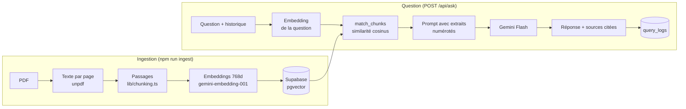

# Vita · assistant RAG pour l'assurance santé

> Projet personnel de démonstration. Vita Mutuelle, ses garanties et ses tarifs sont fictifs. Les documents ont été rédigés pour le projet : aucun document interne d'un assureur réel n'est utilisé.

**En une phrase :** Vita rend les contrats santé compréhensibles, avec une IA qui prouve chacune de ses réponses.

## Pourquoi ce projet ?

Les contrats de mutuelle sont **difficiles à comprendre**. Les notices font des dizaines de pages, les tableaux de garanties parlent en « % BR » et en « frais réels », et la question la plus simple (« combien je serai remboursé ? ») demande souvent d'appeler un conseiller.

Les assistants IA classiques répondent vite, mais ils **inventent parfois des chiffres**. Dans l'assurance, une réponse fausse n'est pas acceptable.

L'idée de Vita : un assistant qui répond **uniquement à partir des documents du contrat**, qui **montre la page source** de chaque réponse, et qui dit « je ne sais pas » quand l'information n'y est pas.

## Que fait le projet ?

Vita est un site de mutuelle (fictive) avec une assistante IA intégrée :

1. **Répondre avec les sources** : « Combien pour un dermatologue en secteur 2 ? » → réponse en langage simple, chaque chiffre relié à la page du PDF, consultable en un clic.
2. **Comparer les offres** : une page Garanties présente chaque produit (formules, tarifs, remboursements soin par soin).
3. **Transformer un PDF en données** : on dépose le tableau de garanties d'une mutuelle, et ses produits et tarifs sont extraits automatiquement, publiés sur le site et appris par l'assistante.
4. **Orienter selon sa situation** : « Je suis marié, deux enfants, mon épouse est infirmière libérale » → Vita pose les questions utiles, puis propose des pistes (santé, prévoyance) en expliquant pourquoi. Elle oriente, elle ne décide pas.

## Comment ça marche ?

**La technique du RAG** (génération augmentée par recherche) :

```
PDF → découpage en passages → chaque passage devient un vecteur (son « sens »)
                                              ↓
Question → vecteur → recherche des passages les plus proches → l'IA répond avec ces seuls passages + citations
```

**Les briques :**
- **Next.js** : le site et l'API dans un seul projet ; les clés restent côté serveur.
- **Google Gemini** : les embeddings (le « sens » des textes) et la rédaction des réponses.
- **Supabase (pgvector)** : stockage des documents et recherche par similarité.
- **Zod** : vérifie que chaque donnée extraite par l'IA respecte le format attendu.

**Les garde-fous de fiabilité :**
- l'IA ne peut répondre qu'à partir des extraits fournis, et doit les citer ;
- pour l'orientation, ce sont **des règles transparentes** qui choisissent les pistes, l'IA ne fait que les expliquer ;
- **un jeu de 30 questions de référence** mesure automatiquement si la bonne source est trouvée, si la réponse est juste et si rien n'est inventé, pour détecter toute régression ;
- **une page de supervision** suit l'utilisation : questions, temps de réponse, coût en tokens, erreurs, avis des utilisateurs.

Le détail technique de chaque brique suit ci-dessous.

## Ce que fait l'application

| Page | Rôle |
| --- | --- |
| `/` | Site de la mutuelle : formules, tableau des garanties, documents, FAQ. Vita est disponible partout via un widget. |
| `/assistant` | Conversation plein écran avec Vita. Réponses avec citations `[1]`, extraits sources dépliables. |
| `/extraction` | PDF vers JSON : chaque garantie (soin, formule, montant, unité, conditions, page). |

Vita garde la conversation dans le navigateur jusqu'à ce que l'utilisateur clique sur **Nouvelle discussion**. Les derniers échanges sont envoyés à l'API, ce qui permet les relances du type « et avec la formule Sérénité ? ».

## Architecture

Un seul projet Next.js : les pages React pour l'interface, et des **Route Handlers** (`app/api/*/route.ts`) qui s'exécutent côté serveur. Les clés Gemini et Supabase ne quittent jamais le serveur.



### Les étapes du RAG

1. **Découpage** (`lib/chunking.ts`) : le texte de chaque page est coupé en passages d'environ 1 000 caractères, sans jamais couper une phrase, avec un léger chevauchement. Un passage reste sur une seule page, pour pouvoir citer la page.
2. **Embeddings** (`lib/gemini.ts`) : chaque passage devient un vecteur de 768 nombres qui représente son sens. Les passages et les questions sont encodés avec des `taskType` différents (`RETRIEVAL_DOCUMENT` / `RETRIEVAL_QUERY`), puis normalisés.
3. **Recherche** (`lib/retrieval.ts`, fonction SQL `match_chunks`) : la question est transformée en vecteur, et pgvector renvoie les 5 passages les plus proches (distance cosinus, index HNSW). En dessous d'un seuil de similarité, rien n'est renvoyé.
4. **Génération** (`lib/prompt.ts`, `lib/rag.ts`) : les passages sont numérotés `[1]`, `[2]`… dans le prompt. Le modèle doit répondre uniquement à partir de ces extraits et citer leurs numéros. Les citations sont ensuite reliées au document et à la page.
5. **Journalisation** : chaque question est enregistrée dans `query_logs` (réponse, passages utilisés, durée, tokens, modèle, erreur).

### Orientation vers une formule

Quand l'utilisateur demande une proposition (« je suis marié avec deux enfants, mon épouse est infirmière libérale de 47 ans, quelle offre nous conviendrait ? »), Vita passe en mode orientation (`lib/orientation.ts`) :

1. **Profil** : Gemini transforme la conversation en profil structuré (foyer, âges, statuts, besoins, budget), validé par Zod. Une profession libérale devient « indépendant ».
2. **Questions** : s'il manque les besoins ou le budget, Vita pose une ou deux questions, avec des réponses en un clic.
3. **Pistes** : des règles déterministes notent chaque formule à partir des garanties et tarifs structurés (besoins du foyer, budget, produits réservés à un âge) et ajoutent la prévoyance adaptée (revenus pour un indépendant, décès avec des enfants à charge).
4. **Explication** : Vita présente les pistes en citant les documents, avec des cartes vers les pages produit, et rappelle qu'il s'agit d'une orientation, pas d'un conseil.

Le LLM lit et explique, mais ne choisit pas : le classement est reproductible et testé.

### Extraction structurée

`/api/extract` envoie le PDF directement à Gemini (`inline_data`), avec `responseMimeType: "application/json"` et un `responseSchema`. Le JSON reçu est revalidé avec **Zod** (`lib/schemas.ts`) : une catégorie inconnue, un montant écrit en texte ou un champ manquant sont rejetés.

### Choix techniques

- **Pas de LangChain** : découpage, recherche et prompt sont écrits à la main, en quelques fonctions courtes, pour pouvoir expliquer chaque étape.
- **Modèles de secours** : si `gemini-2.5-flash` est saturé (503) ou a épuisé son quota gratuit (429), l'appel passe automatiquement au modèle suivant (`lib/gemini.ts`).
- **Sécurité** : RLS activé sans aucune policy sur les tables, et fonction de recherche fermée au public. Seuls les Route Handlers, avec la clé secrète, accèdent aux données. Les entrées de l'API sont validées avec Zod.

## Qualité et évaluation

### Tests

```bash
npm test
```

19 tests Vitest : découpage du texte, fonctions de notation de l'évaluation, schéma Zod de l'extraction.

### Jeu d'évaluation

`eval/questions.json` contient **30 questions de référence** sur les 3 documents. Chacune donne les sources attendues (document et page) et les informations que la réponse doit contenir. 5 questions portent sur des sujets absents des documents : Vita doit refuser d'y répondre.

```bash
npm run eval                        # évaluation complète
npm run eval -- --retrieval-only    # recherche seulement (ne consomme pas de quota de génération)
npm run eval -- --save-baseline     # enregistre le résultat comme référence
```

| Métrique | Ce qui est mesuré |
| --- | --- |
| Recherche | Un passage du bon document, à la bonne page, fait partie des 5 passages retrouvés |
| Citation | La réponse cite ce document et cette page |
| Réponse correcte | La réponse contient les informations attendues, ou refuse si la question est hors documents |
| Sans invention | Chaque nombre de la réponse figure dans les extraits fournis au modèle |

Le script compare les scores à `eval/baseline.json` et échoue si une métrique baisse de plus de 5 points. On peut donc modifier le découpage, le prompt ou le modèle et voir tout de suite si la qualité régresse.

**Résultats actuels**

- Recherche : **100 %** sur les 25 questions qui ont une réponse dans les documents.
- Évaluation complète : en attente d'une exécution complète. Le quota gratuit de Gemini est limité à quelques dizaines de requêtes par jour. Sur une première exécution partielle (13 questions), toutes les réponses étaient justes et sans invention.

## Lancer le projet

Prérequis : Node 22, une clé API Gemini (palier gratuit sur aistudio.google.com) et un projet Supabase.

```bash
nvm use 22
npm install
cp .env.example .env.local    # puis remplir les clés
```

1. Dans Supabase, ouvrir **SQL Editor** et exécuter `supabase/schema.sql`.
2. Indexer les documents :

```bash
npm run ingest -- public/documents/vita-notice-2026.pdf "Notice d'information 2026"
npm run ingest -- public/documents/vita-tableau-garanties-2026.pdf "Tableau des garanties 2026"
npm run ingest -- public/documents/vita-guide-100-sante.pdf "Guide du 100 % Santé"
```

3. Lancer le site :

```bash
npm run dev
```

Les PDF de démonstration sont générés par `scripts/generate-documents.py` (reportlab).

## Structure

```
app/
  page.tsx                 site de la mutuelle
  assistant/page.tsx       conversation plein écran
  extraction/page.tsx      extraction PDF -> JSON
  api/ask/route.ts         question -> RAG -> réponse sourcée
  api/extract/route.ts     PDF -> garanties en JSON
components/vita/           widget, conversation, logo
lib/
  chunking.ts              découpage en passages
  gemini.ts                embeddings, génération, sortie JSON, modèles de secours
  retrieval.ts             recherche pgvector
  prompt.ts                prompt système et citations
  rag.ts                   pipeline complet
  ingest.ts                PDF -> Supabase
  extract.ts, schemas.ts   extraction structurée et schémas Zod
supabase/schema.sql        tables, index HNSW, match_chunks, RLS
eval/                      questions de référence, notation, script d'évaluation
tests/                     tests Vitest
```

## Crédits photos

Les photos des produits sont libres de droits ([licence Unsplash](https://unsplash.com/license)) : National Cancer Institute, Eliott Reyna, Hector Reyes, Ryno Marais, Mike Scheid, Age Cymru, David Travis et SoyBreno. Chaque page produit crédite sa photo.

## Stack

Next.js (App Router) · TypeScript · Tailwind CSS v4 · Google Gemini (`gemini-2.5-flash`, `gemini-embedding-001`) · Supabase (Postgres, pgvector, Storage) · unpdf · Zod · Vitest
